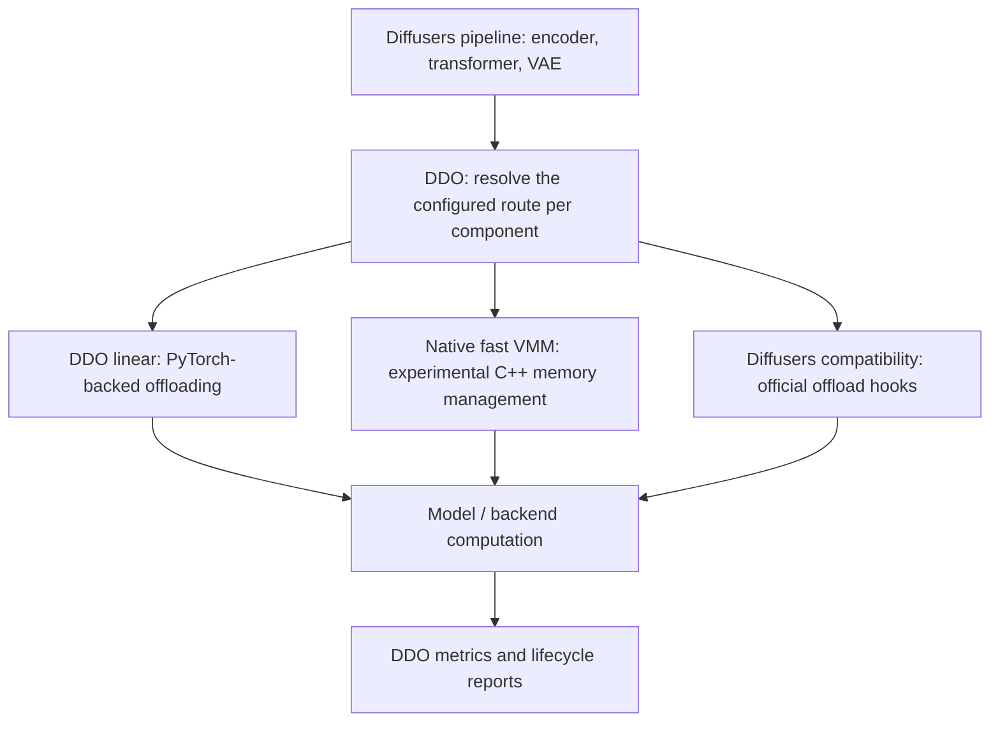

# Diffusers Dynamic Offloader

DDO is a model-agnostic offload manager for low-VRAM Diffusers-style inference.
It provides dense-weight routes and official Diffusers compatibility routes
while preserving quantized backend math.

DDO moves model weights between CPU memory and the GPU as components run. It
manages loading, transfers and resource lifetime; Diffusers and the selected
backend still perform the model computation. Encoder, transformer and VAE phases
can use different strategies, including official Diffusers leaf offloading.

## Runtimes: how DDO executes offloading

A **runtime** is the implementation that manages weight placement, transfers
and reuse while the model runs. DDO provides several routes so that a workload
can use PyTorch-backed offloading, native memory management or official
Diffusers hooks. The model/backend still owns the computation.

| Route | What it does | Status / scope |
| --- | --- | --- |
| **DDO linear** (`linear_runtime`) | Uses PyTorch-backed offloading for dense weights; no native allocator is required. | Established default route, including `one_shot_fast`, `low_ram_safe`, `wsl_compat` and `warm_process` policies. |
| **DDO native fast VMM** (`vmm_fast_runtime`) | Uses the optional C++ allocator, bounded GPU arena and retained weight sources. | Experimental; selected Windows, native Linux and WSL workloads are validated separately. |
| **NVMe-backed VMM** (`vmm_runtime`) | Uses NVMe storage as a backing source for weights and manages GPU residency through VMM. | Maintained baseline/fallback, selected explicitly with `vmm/nvme_baseline`; separate from native fast. |
| **Diffusers compatibility** | Delegates offloading to official Diffusers block/group or leaf hooks and preserves backend forwards. | Maintained compatibility routes, useful alone or alongside DDO strategies in other phases. |
| **SDNQ packed route** (`sdnq_runtime`) | Offloads supported packed modules while preserving SDNQ computation. | Backend-specific, selected recipes only; not general quantization or native VMM support. |

A **backend** selects a runtime family; a **preset** selects its policy.
For dense weights, `linear/auto` selects `one_shot_fast`, while `vmm/auto`
selects experimental native fast VMM. The `off` preset leaves placement to the
caller. An encoder, transformer and VAE can use different routes; choosing VMM
for the transformer does not make the entire pipeline native.

The current `0.1.0rc3` package is an **experimental prerelease**, including the
established linear route. A route's status does not certify every model,
architecture or hardware configuration. See [presets and component policies](docs/user/presets-and-platforms.md)
and [support boundaries](docs/developer/support.md).

## Architecture overview

DDO configures offloading per component. For example, an encoder can use
Diffusers leaf offloading while the transformer uses a DDO runtime.



The branches show alternative routes, not automatic performance tuning or
parallel execution. This overview highlights the main choices; the runtime
table above also covers the NVMe baseline and SDNQ route. See the
[detailed architecture](docs/developer/architecture.md) for native ownership,
memory management and safe cleanup.

## What native VMM adds

The native fast route also provides a bounded weight transport: parallel native
file reads, retained CPU source bytes, independently limited CUDA registration,
reusable staging buffers and asynchronous uploads. Supported weights remain
associated with immutable checkpoint slices, allowing repeated delivery without
retaining loader CPU tensors as the source cache. See the
[native loading and transport architecture](docs/developer/architecture.md#native-weight-loading-and-transport)
for the data paths, fallback behavior and measurements used to assess their benefit.

VMM means **CUDA Virtual Memory Management**. The optional native allocator keeps
GPU pointer addresses stable while managing the physical memory behind them.
The native fast route uses a bounded weight arena, reusable execution buffers
and completion events to reuse memory safely and upload weights when needed.
It does not reserve all GPU memory, pin every allocation in local VRAM, compress
activations or change the model's attention/math. Windows may still page GPU
allocations under pressure.

Choose a route per workload and component; native VMM does not replace every
Diffusers offloading strategy. See [native integration](docs/user/native-vmm.md) and
[architecture](docs/developer/architecture.md) for the contracts.

## Measured example

LTX 2.3 BF16 video, Windows, RTX 3060 Ti **8 GiB**, 64 GiB system RAM:
1280×704, 5 seconds/121 frames, 8 steps. These existing measurements use a shared
Diffusers leaf text encoder and resident temporal VAE; the method column names
the **transformer** route. GPU peaks are sampled absolute driver usage; RAM peaks
are process RSS. Times are seconds and memory is GiB.

Before comparing rows, read the [labels and memory glossary](https://devaiexp.github.io/ddo-examples/docs/benchmarks/glossary/)
for runtime labels, latency scope and peak-memory definitions.

| Runtime method | Denoise (s) | Video VAE decode (s) | Tracked total (s) | Peak GPU (absolute, GiB) | Peak RAM (RSS, GiB) |
| --- | ---: | ---: | ---: | ---: | ---: |
| Diffusers streamed leaf | 392.91 | 22.52 | 452.33 | 4.72 | 41.34 |
| DDO linear (`one_shot_fast`) | 262.22 | 23.47 | 336.44 | 4.72 | 47.87 |
| DDO native VMM (`vmm_fast`) | 207.40 | 24.00 | 277.09 | 5.21 | 32.65 |

Video VAE decode excludes decoder loading, audio decode and vocoder work. The
tracked total already includes these phases; it is not denoise plus decode.

This is a selected pipeline comparison, not an allocator-only ablation or a
universal speedup. Tracked total excludes command startup and downloads. Read
the [video phases and conditions](https://devaiexp.github.io/ddo-examples/docs/benchmarks/ltx23-video/#windows-bf16)
and [comparison summary](https://devaiexp.github.io/ddo-examples/docs/benchmarks/summary/)
before choosing a route. In the Windows LTX image comparison, linear has the
shorter denoise while native has the shorter total. Leaf VAE can reduce decoder
GPU peaks at additional latency; component strategies can be combined.

## Getting started

Follow the [installation guide](docs/user/installation.md), then choose
[full-pipeline](docs/user/full-pipeline.md), [staged](docs/user/staged-pipeline.md)
or [Modular Diffusers](docs/user/modular-pipeline.md) integration.

Normal linear use requires no native allocator or compiler. Native VMM is optional:
it uses a matching packaged DLL/.so and bootstrap before CUDA initialization.
Experimental version `0.1.0rc3` is available on PyPI. The installation guide
uses published packages, without requiring a source clone or local wheel files.

```python
from diffusers_dynamic_offloader import enable_offload

result = enable_offload(transformer, preset="auto", component="transformer")
transformer = result.module
```

This snippet selects the default linear route. See
[native VMM integration](docs/user/native-vmm.md) for its separate loading contract.

## Documentation

Read the [documentation website](https://devaiexp.github.io/diffusers-dynamic-offloader/)
or browse the Markdown guides below.

- [User guides](docs/user/README.md): installation, integration, presets and reporting.
- [Developer guides](docs/developer/README.md): architecture, diagnostics, builds and validation.

On the website, use the top **User guides**, **Developer guides** and
**Benchmarks** menus to change pages. The left contents list links to sections
within the current page; short sections may already be visible.

## Examples and benchmarks

Model runners, custom-block integration and measured comparisons live in
[DDO examples](https://github.com/DEVAIEXP/ddo-examples).
See the [test hardware](docs/developer/hardware.md) and
[support boundaries](docs/developer/support.md) when interpreting results.
Selected workloads do not establish universal speedups or model support.

## License

Apache-2.0; preserve required copyright, license and attribution notices.
