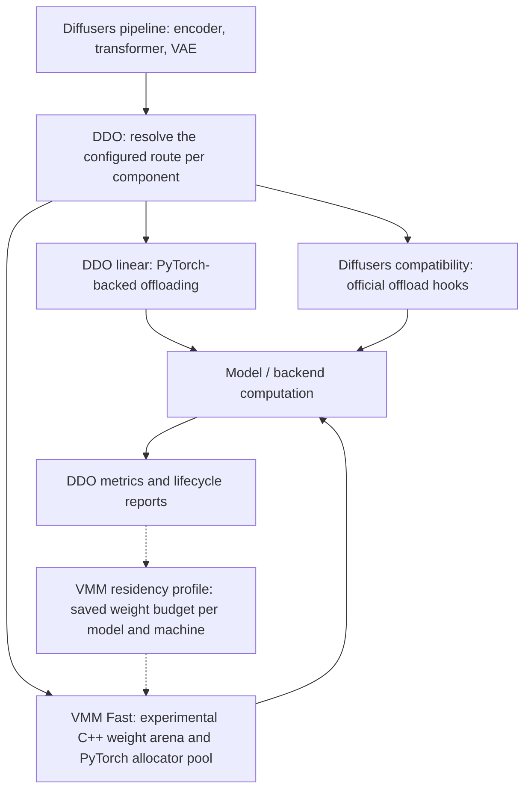

# Diffusers Dynamic Offloader

DDO is a model-agnostic offload manager for low-VRAM Diffusers-style inference.
It provides dense-weight routes and official Diffusers compatibility routes
while preserving quantized backend math.

DDO moves model weights between CPU memory and the GPU as components run. It
manages loading, transfers and resource lifetime; Diffusers and the selected
backend still perform the model computation. Encoder, transformer and VAE phases
can use different strategies, including official Diffusers leaf offloading.

## Design goal

DDO manages how much of the model's weights stay on the GPU, leaving room for activations and temporary buffers. The goal is to make larger inference workloads practical on GPUs with limited VRAM. Moving weights on demand has a cost, and its impact on runtime depends on the workload and the available memory.

Benchmarks should show whether the same workload completes on each runtime, how much VRAM it uses, and how long it takes. A workload that puts pressure on one GPU may leave substantial headroom on another, so the benchmark context matters when interpreting the results.

## Runtimes and presets

A **runtime** is the implementation that manages weight placement, transfers
and reuse while the model runs. DDO provides several routes so that a workload
can use PyTorch-backed offloading, native memory management or official
Diffusers hooks. The model/backend still owns the computation.

| Route | What it does | Status / scope |
| --- | --- | --- |
| **DDO linear** (`linear_runtime`) | Uses PyTorch-backed offloading for dense weights; no native allocator is required. | Established default route, including `one_shot_fast`, `low_ram_safe`, `wsl_compat` and `warm_process` policies. |
| **VMM Fast** (`vmm_fast_runtime`) | Uses the optional C++ allocator, bounded GPU arena and retained weight sources. | Experimental; selected Windows, native Linux and WSL workloads are validated separately. |
| **NVMe-backed VMM** (`vmm_runtime`) | Uses NVMe storage as a backing source for weights and manages GPU residency through VMM. | Maintained baseline/fallback, selected explicitly with `vmm/nvme_baseline`; separate from native fast. |
| **Diffusers compatibility** | Delegates offloading to official Diffusers block/group or leaf hooks and preserves backend forwards. | Maintained compatibility routes, useful alone or alongside DDO strategies in other phases. |
| **SDNQ packed route** (`sdnq_runtime`) | Offloads supported packed modules while preserving SDNQ computation. | Backend-specific, selected recipes only; not general quantization or native VMM support. |

A **backend** selects a runtime family; a **preset** selects its policy.
For dense weights, `linear/auto` selects `one_shot_fast`, while `vmm/auto`
selects experimental VMM Fast. The `off` preset leaves placement to the
caller. An encoder, transformer and VAE can use different routes; choosing VMM
for the transformer does not make the entire pipeline native.

This documentation targets the **experimental RC5 prerelease**, including the
established linear route. Published and locally validated artifacts are listed
in [package delivery](docs/developer/releases.md). A route's status does not certify every model,
architecture or hardware configuration. See [runtimes and presets](docs/user/presets-and-platforms.md)
and [support boundaries](docs/developer/support.md).

## Architecture overview

DDO configures offloading per component. For example, an encoder can use
Diffusers leaf offloading while the transformer uses a DDO runtime.



The branches show alternative routes, not parallel execution. The dotted
profile loop applies to VMM Fast only: one measured build saves the
residency budget that later runs use; it is not continuous tuning. This overview highlights the main choices; the runtime
table above also covers the NVMe baseline and SDNQ route. See the
[detailed architecture](docs/developer/architecture.md) for native ownership,
memory management and safe cleanup.

## VMM Fast

VMM means **CUDA Virtual Memory Management**: GPU addresses and the physical
memory storing their contents can be managed separately. VMM Fast keeps the
addresses used by the model stable while safely reusing physical GPU memory.
It uploads weights as they are needed and can retain frequently used weights
within a configured budget.

Native transport also manages checkpoint reads, retained CPU source bytes,
CUDA registration and reusable upload buffers with separate limits. See
[integration](docs/user/integration.md) for the common application flow and
[architecture](docs/developer/architecture.md) for resource ownership.

## Measured example

LTX 2.3 Distilled BF16 video on Windows: RTX 3060 Ti **8 GiB**, 64 GiB
system RAM, NVIDIA driver **617.42**. The workload is 1280×704, **8 seconds /
193 frames**, 24 fps, eight steps and seed 43, with image/audio conditioning,
default SDPA and CUDA exact-streaming decode. Model optimizations are disabled.

The table reports the **full tracked run**: all measured loading, encoding,
denoising, cleanup, decoding and saving phases. It excludes command startup and
downloads. GPU peaks are sampled absolute driver usage; RAM peaks are process
RSS. Times are seconds and memory is GiB.

| Preset | Transformer runtime | Encoder route | VAE route | Full run latency (s) | Peak GPU (GiB) | Peak RAM (GiB) |
| --- | --- | --- | --- | ---: | ---: | ---: |
| Official Leaf | Official Diffusers hooks | Leaf | Resident | 421.12 | 8.00 | 41.34 |
| `one_shot_fast` | `linear_runtime` | Leaf | Leaf | 403.49 | 8.00 | 50.35 |
| `low_ram_safe` | `linear_runtime` | Leaf | Leaf | 482.05 | 8.00 | 42.36 |
| `vmm_fast` | `vmm_fast_runtime` | Native VMM | Resident | 384.23 | 8.00 | 33.08 |

Leaf uses no standby purge; the three DDO cases purge before the transformer.
The component routes and purge policies are part of these recipes. This is a
selected pipeline comparison, not an isolated allocator comparison.

See the [current video measurements](https://devaiexp.github.io/ddo-examples/docs/benchmarks/ltx23-video/#windows-bf16-8-second-pressure-workload)
for separate denoising and VAE decode latency and peaks, and the
[benchmark overview](https://devaiexp.github.io/ddo-examples/docs/benchmarks/)
for model comparisons and recommendations. The
[measurement glossary](https://devaiexp.github.io/ddo-examples/docs/benchmarks/glossary/)
defines the timing and memory scopes.

## Getting started

Follow the [installation guide](docs/user/installation.md) and
[common integration flow](docs/user/integration.md), then choose
[full-pipeline](docs/user/full-pipeline.md), [staged](docs/user/staged-pipeline.md)
or [Modular Diffusers](docs/user/modular-pipeline.md) integration.

Normal linear use requires no native allocator or compiler. Native VMM is optional:
it uses a matching packaged DLL/.so and bootstrap before CUDA initialization.
Use a matching package pair for your platform; see the installation guide
for the target version and package availability.

```python
from diffusers_dynamic_offloader import enable_offload

result = enable_offload(transformer, preset="auto", component="transformer")
transformer = result.module
```

This snippet selects the default linear route. See
[integration](docs/user/integration.md) for VMM Fast selection and loading.

## Documentation

Read the [documentation website](https://devaiexp.github.io/diffusers-dynamic-offloader/)
or browse the Markdown guides below.

- [User guides](docs/user/README.md): installation, integration, presets, reporting and
  [troubleshooting](docs/user/troubleshooting.md).
- [Developer guides](docs/developer/README.md): architecture, diagnostics, builds and validation.

On the website, use the top **User guides**, **Developer guides** and
**Benchmarks** menus to change pages. The left contents list links to sections
within the current page; short sections may already be visible.

## Examples and benchmarks

Model runners, custom-block integration and measured comparisons live in
[DDO examples](https://github.com/DEVAIEXP/ddo-examples).
See the [test hardware](docs/developer/hardware.md) and
[support boundaries](docs/developer/support.md) when interpreting results.
Selected workloads do not establish universal speedups or model support.

## License

Apache-2.0; preserve required copyright, license and attribution notices.
