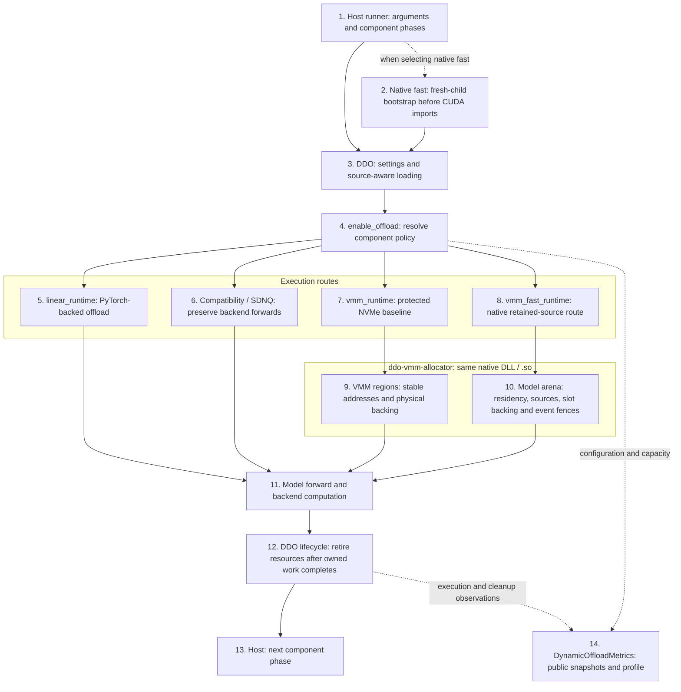
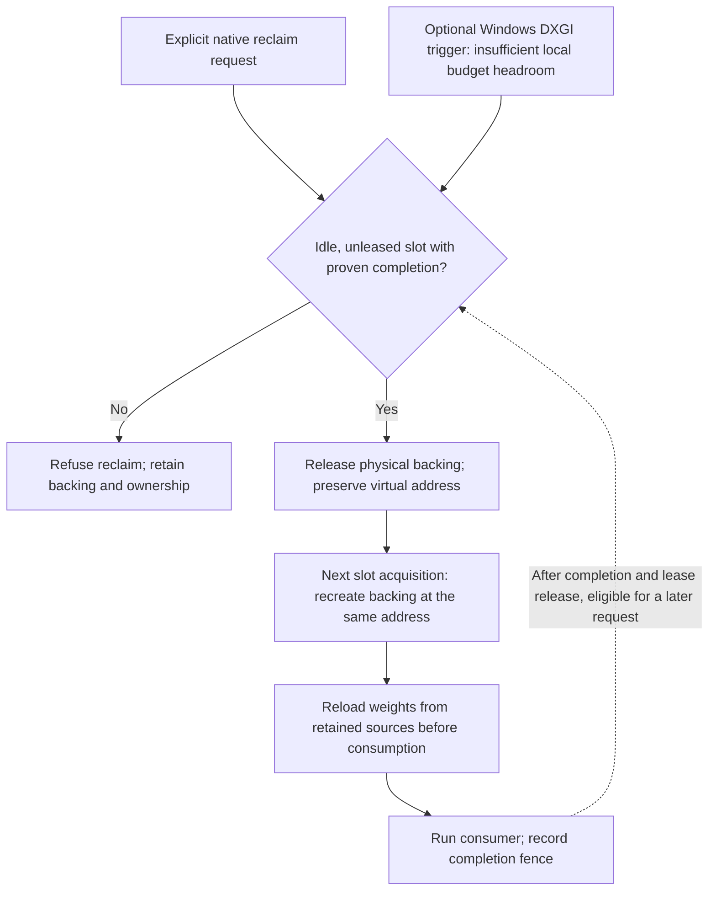

# Runtime architecture and ownership

## Integration boundary

Solid arrows show integration and resource flow, not a single CUDA stream or a
guarantee that transfers overlap computation.

## Diagram guide

Numbers identify boxes, not mandatory sequential steps. Boxes 5–8 are alternative
routes; the enclosing frames group execution routes and native-library ownership.

1. **Host runner.** Parses arguments and coordinates component phases. It chooses
   the offload policy, not which individual weights stay in GPU memory. Model
   runners and custom blocks belong to independent model repositories; DDO stays
   model-agnostic.
2. **Native bootstrap.** For native fast execution, relaunches the command in a
   fresh child and installs the process-wide allocator before imports that can
   initialize CUDA. Other routes do not require this bootstrap.
3. **Settings and loading.** Resolves configuration and associates supported
   checkpoint sources with the loaded component.
4. **Component policy.** `enable_offload` resolves the preset, backend and explicit
   component overrides, then attaches the selected execution route. Components
   in the same pipeline can use different routes. See
   [component policy](../user/component-strategies.md).
5. **Linear runtime.** Manages dense-weight offload using normal PyTorch allocation;
   it preserves the linear presets and needs no native allocator or compiler.
6. **Compatibility / SDNQ.** Uses the applicable backend-preserving route. Official
   Diffusers hooks and DDO's SDNQ route are distinct implementations, grouped here
   because neither replaces quantized backend computation with dense math.
7. **Protected NVMe runtime.** `nvme_baseline` uses Python-coordinated execution
   groups and transfer buffers through `VmmWeightArena`, backed by native VMM
   regions. This selects `vmm_runtime`, the protected fallback.
8. **Native fast runtime.** `vmm_fast` connects component hooks to the native model
   arena and persistent source storage through `ModelArenaWeightStore`. This
   selects `vmm_fast_runtime`. See [native integration](../user/native-vmm.md).
9. **VMM regions.** Supply stable virtual addresses and physical backing for the
   protected route. Both VMM routes use the same DLL/.so, but different adapters
   and native structures.
10. **Model arena.** Native C++ manages which weights occupy GPU memory, source
    bytes, CUDA host-memory registration, reusable transfer buffers and memory
    limits. Source bytes are kept independently of loader CPU tensors. Storage,
    registration and GPU memory have separate limits; unregistering must preserve
    stored bytes. On Linux, allocation checks use the actual overcommit mode,
    `MemAvailable`, cgroup v2 and process limits. Mode 2 also enforces the remaining
    `CommitLimit`; modes 0/1 keep finite bounds. Missing observations must refuse
    growth, not trigger a change to OS memory policy.
11. **Model computation.** Executes the model/backend forward. DDO owns transport
    and lifetime, not timestep, attention or dequantization mathematics. Saved
    TorchAO payload transport does not replace TorchAO operators.
12. **Resource cleanup.** Reuses or releases tensors, sources, transfer slots and
    GPU backing only after CUDA events confirm all work using them has completed.
    Partial failures keep ownership until completion is confirmed. Temporary
    fallbacks need the same protection and must report their reason and bytes.
    A corrupted CUDA context does not permit unsafe freeing or an automatic
    device reset.
13. **Next component phase.** Returns orchestration to the host, which can prepare
    another component after the required cleanup boundary.
14. **Public report.** Exposes configuration, capacity and execution observations
    through `DynamicOffloadMetrics`, `as_dict()` and `format_profile()`. Profiles
    describe capacity; they do not tune GPU residency in Python. Hosts consume
    this public interface, not internal hook or planner fields.

## Optional execution-slot backing cycle

This cycle expands the native execution slots in box 10. Explicit release and
recreation share native code on Windows and Linux. The automatic DXGI trigger is
Windows-only, opt-in and disabled by default; Linux does not use that trigger.

Recreation and upload remain subject to native admission and fixed capacities.
A completion, unmap or release failure retains unsafe ownership and refuses
reuse/close; it does not take the normal recreation path shown above. The cycle
does not evict or compress activations, move them explicitly into WDDM memory,
or guarantee physical local-VRAM placement. Automatic Windows reclaim may release
at most one eligible slot per allocation request; shared code does not imply the
same pressure policy on every platform. See [native configuration and scope](../user/native-vmm.md#optional-execution-slot-backing-reclaim).

See the complementary [runner-level architecture](https://github.com/DEVAIEXP/ddo-examples/blob/main/docs/developer/architecture.md)
for Modular Diffusers phase orchestration and output reporting.

