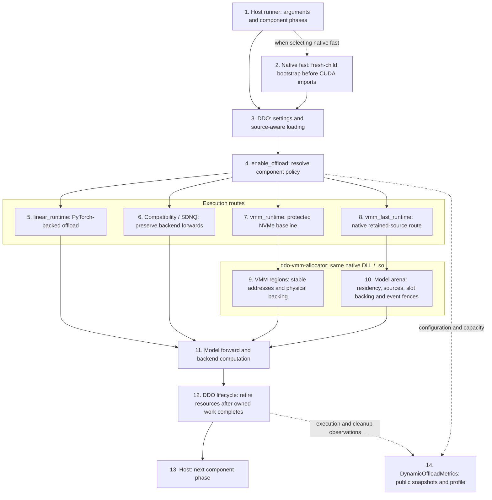
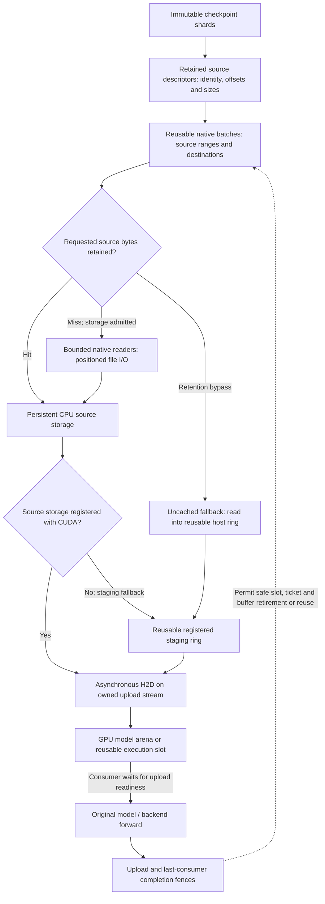
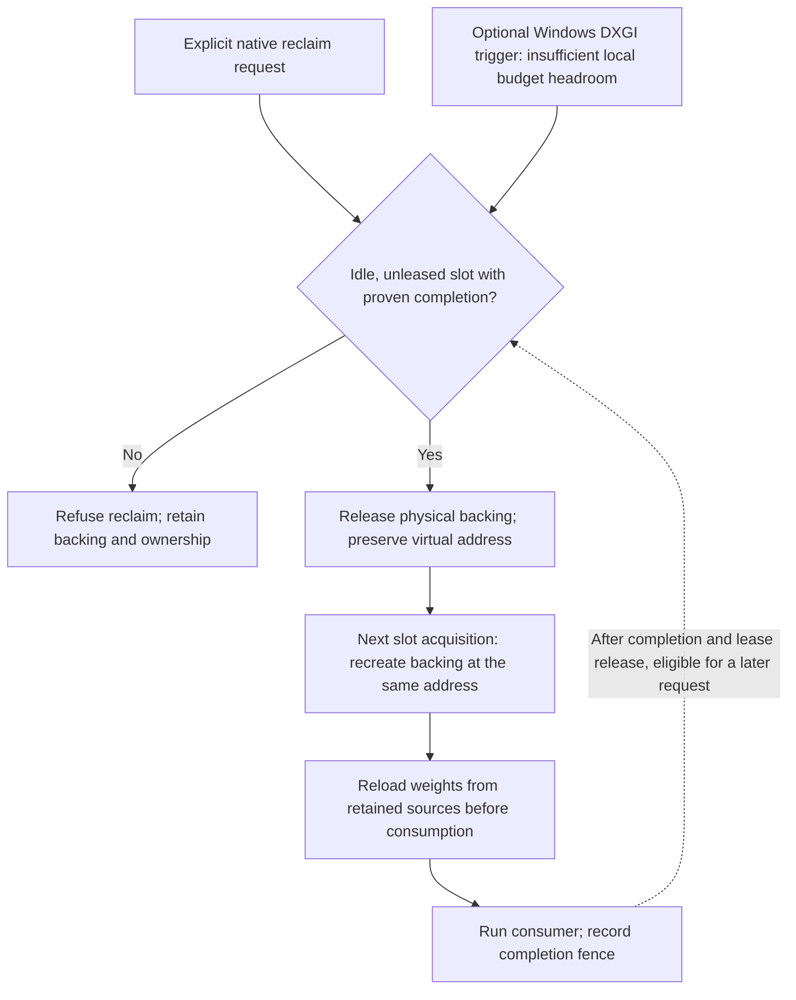

# Runtime architecture and ownership

## Integration boundary

Solid arrows show integration and resource flow, not a single CUDA stream or a
guarantee that transfers overlap computation.

## Diagram guide

Numbers identify boxes, not mandatory sequential steps. Boxes 5–8 are alternative
routes; the enclosing frames group execution routes and native-library ownership.

1. **Host runner.** Parses arguments and coordinates component phases. It chooses
   the offload policy, not which individual weights stay in GPU memory. Model
   runners and custom blocks belong to independent model repositories; DDO stays
   model-agnostic.
2. **Native bootstrap.** For native fast execution, relaunches the command in a
   fresh child and installs the process-wide allocator before imports that can
   initialize CUDA. Other routes do not require this bootstrap.
3. **Settings and loading.** Resolves configuration and associates supported
   checkpoint sources with the loaded component.
4. **Component policy.** `enable_offload` resolves the preset, backend and explicit
   component overrides, then attaches the selected execution route. Components
   in the same pipeline can use different routes. See
   [component policy](../user/component-strategies.md).
5. **Linear runtime.** Manages dense-weight offload using normal PyTorch allocation;
   it preserves the linear presets and needs no native allocator or compiler.
6. **Compatibility / SDNQ.** Uses the applicable backend-preserving route. Official
   Diffusers hooks and DDO's SDNQ route are distinct implementations, grouped here
   because neither replaces quantized backend computation with dense math.
7. **Protected NVMe runtime.** `nvme_baseline` uses Python-coordinated execution
   groups and transfer buffers through `VmmWeightArena`, backed by native VMM
   regions. This selects `vmm_runtime`, the protected fallback.
8. **Native fast runtime.** `vmm_fast` connects component hooks to the native model
   arena and persistent source storage through `ModelArenaWeightStore`. This
   selects `vmm_fast_runtime`. See [native integration](../user/native-vmm.md).
9. **VMM regions.** Supply stable virtual addresses and physical backing for the
   protected route. Both VMM routes use the same DLL/.so, but different adapters
   and native structures.
10. **Model arena.** Native C++ manages which weights occupy GPU memory, source
    bytes, CUDA host-memory registration, reusable transfer buffers and memory
    limits. Source bytes are kept independently of loader CPU tensors. Storage,
    registration and GPU memory have separate limits; unregistering must preserve
    stored bytes. On Linux, allocation checks use the actual overcommit mode,
    `MemAvailable`, cgroup v2 and process limits. Mode 2 also enforces the remaining
    `CommitLimit`; modes 0/1 keep finite bounds. Missing observations must refuse
    growth, not trigger a change to OS memory policy.
11. **Model computation.** Executes the model/backend forward. DDO owns transport
    and lifetime, not timestep, attention or dequantization mathematics. Saved
    TorchAO payload transport does not replace TorchAO operators.
12. **Resource cleanup.** Reuses or releases tensors, sources, transfer slots and
    GPU backing only after CUDA events confirm all work using them has completed.
    Partial failures keep ownership until completion is confirmed. Temporary
    fallbacks need the same protection and must report their reason and bytes.
    A corrupted CUDA context does not permit unsafe freeing or an automatic
    device reset.
13. **Next component phase.** Returns orchestration to the host, which can prepare
    another component after the required cleanup boundary.
14. **Public report.** Exposes configuration, capacity and execution observations
    through `DynamicOffloadMetrics`, `as_dict()` and `format_profile()`. Profiles
    describe capacity; they do not tune GPU residency in Python. Hosts consume
    this public interface, not internal hook or planner fields.

## Native weight loading and transport

The native fast route separates initial component loading from repeated weight
delivery during inference. `from_pretrained_with_dynamic_offload(...)` associates
supported tensors with immutable checkpoint slices. `enable_offload(...)` then
connects component hooks to the native arena and transport. The generic loading
helper alone does not select this transport or replace every loader allocation;
see [dynamic loading](../user/dynamic-loading.md) and
[native integration](../user/native-vmm.md).

The following expands box 10 for file-backed weights in `vmm_fast_runtime`.
It does not describe the linear route or the protected NVMe baseline.

Arrows describe ownership and data paths, not a promise of simultaneous disk,
DMA and compute activity. Retained-source preparation and GPU look-ahead are
distinct: reading bytes into CPU storage does not make them registered or GPU
resident. Optional dispatcher observations depend on native build/API support.

### Resources and responsibilities

| Resource | Capability | Boundary |
| --- | --- | --- |
| Source descriptors | Retain immutable file identity and byte ranges independently of loader CPU tensors. | Checkpoints must remain unchanged while sources are live. Supported source association must be established during loading. |
| Positioned readers | Windows uses overlapped file reads; Linux uses `pread`. A bounded native worker pool reads chunks into owned buffers. | The current implementation uses 2 MiB chunks and at most eight workers, further limited by ring slot count. These are implementation details, not public tuning arguments or evidence of disk saturation. |
| Persistent CPU storage | Retains source bytes so neighboring ranges and later requests can reuse them without another source read. | The storage ceiling is separate from CUDA registration and GPU capacity. Partial coverage can cause rereads or bypasses. |
| CUDA registration | Allows retained host bytes to supply asynchronous transfers directly when admitted. | Unregistering preserves stored content. A registration fallback can stage already retained bytes through the ring without rereading the file. |
| Host ring | Reuses bounded registered staging slots for file reads or copies from unregistered retained bytes. | A slot remains owned until its read and DMA complete. Uncached fallback can wait for file readiness before submitting H2D. |
| Immutable batches | Reuse validated source ranges and destination metadata across uploads, reducing repeated host orchestration. | Batches retain source and transfer ownership through partial failures; they are not a second Python weight cache. |
| GPU arena and execution slots | Keep stable virtual addresses and reuse physical capacity for weights required by the current execution unit. | Virtual reservation, materialized backing and physical local-VRAM placement are different observations. Reuse requires upload and consumer completion. |
| Component hooks | Arrange demand delivery and supported next-unit GPU look-ahead before calling the original forward. | Prefetch admission can be refused by capacity. Model order, attention, timestep and backend mathematics remain outside native transport policy. |

Storage, registration, staging and GPU capacities are independently bounded.
Increasing retained CPU storage does not increase the GPU weight budget, and
reserving GPU virtual addresses does not materialize all of that capacity.
Native admission checks and completion fences remain authoritative on both cache
hits and fallbacks. Missing observations or unproven completion do not authorize
growth, early reuse or forced release.

### Observability and performance interpretation

Read transport observations through `DynamicOffloadMetrics`, `as_dict()` and
`format_profile()`, rather than native handles or hook internals. The
[metric catalog](../user/metrics.md#native-pipeline-source-abi-v11-stats-v8)
documents field availability, units and nested timing scopes.

- Source-read bytes count file reads requested by DDO, including aligned windows;
  the operating system may satisfy them from its page cache. They are not a
  measurement of physical disk traffic.
- DMA bytes describe host-to-device transport, not checkpoint loading or model
  computation. A cache hit can avoid a source read while still requiring H2D.
- `fast_source_cache_batch_bypass_bytes` identifies uncached ring traffic.
  Registration fallback is different: retained bytes can still be available.
- `fast_source_cache_source_ready_seconds` measures host readiness checks/waits
  entering direct retained-source upload; explicit source waits and fallback
  are excluded. It is not total disk service time. Batch submission and registration scopes can
  contain other waits; nested timers must not be summed as independent work.
- GPU prefetch hits and dispatcher window counts establish scheduling events,
  not useful overlap or speedup. Compare complete phases and completed workload
  timings under the same capacities before changing transport policy.

These mechanisms support bounded streaming and reuse without requiring a new
checkpoint format or changing tensor values. They do not compress weights,
provide direct storage-to-GPU DMA, or guarantee that loading is the workload's
bottleneck. Windows, native Linux and WSL have separate capacity and validation
boundaries; see [support](support.md) and [validation](validation.md).

## Optional execution-slot backing cycle

This cycle expands the native execution slots in box 10. Explicit release and
recreation share native code on Windows and Linux. The automatic DXGI trigger is
Windows-only, opt-in and disabled by default; Linux does not use that trigger.

Recreation and upload remain subject to native admission and fixed capacities.
A completion, unmap or release failure retains unsafe ownership and refuses
reuse/close; it does not take the normal recreation path shown above. The cycle
does not evict or compress activations, move them explicitly into WDDM memory,
or guarantee physical local-VRAM placement. Automatic Windows reclaim may release
at most one eligible slot per allocation request; shared code does not imply the
same pressure policy on every platform. See [native configuration and scope](../user/native-vmm.md#optional-execution-slot-backing-reclaim).

See the complementary [runner-level architecture](https://github.com/DEVAIEXP/ddo-examples/blob/main/docs/developer/architecture.md)
for Modular Diffusers phase orchestration and output reporting.

